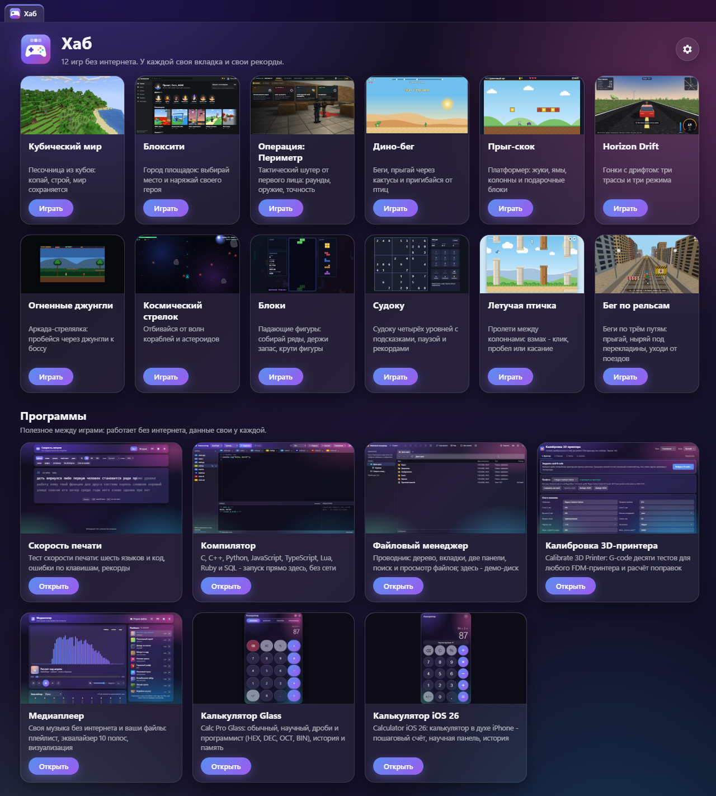
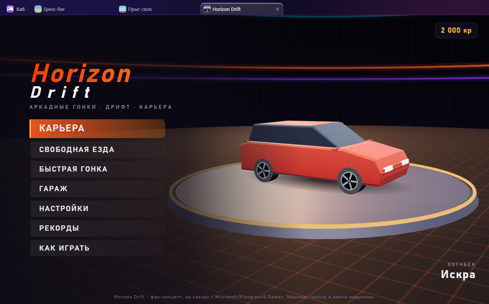
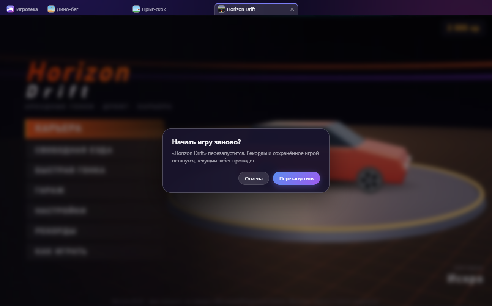
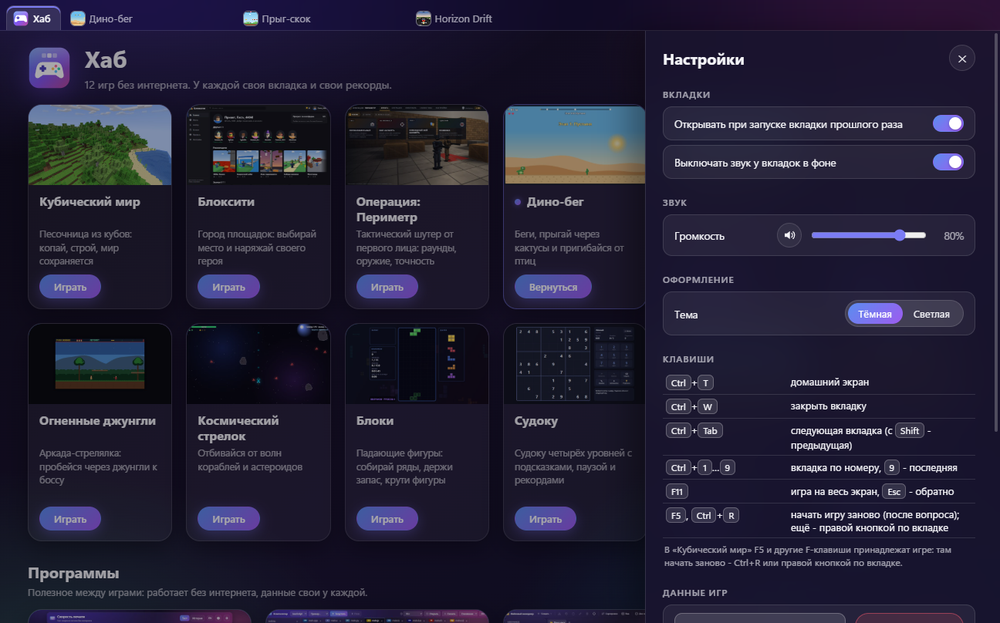
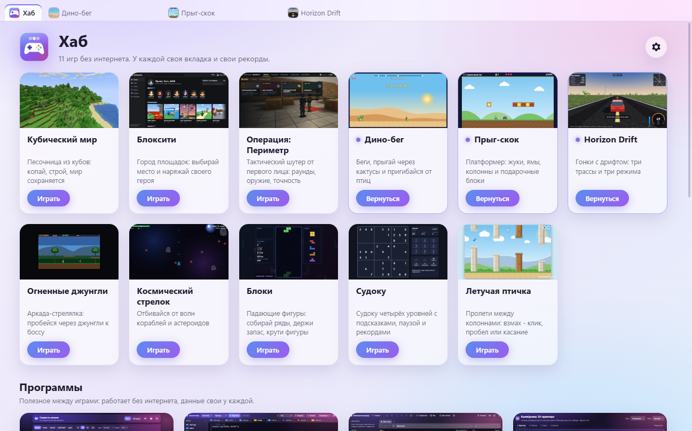
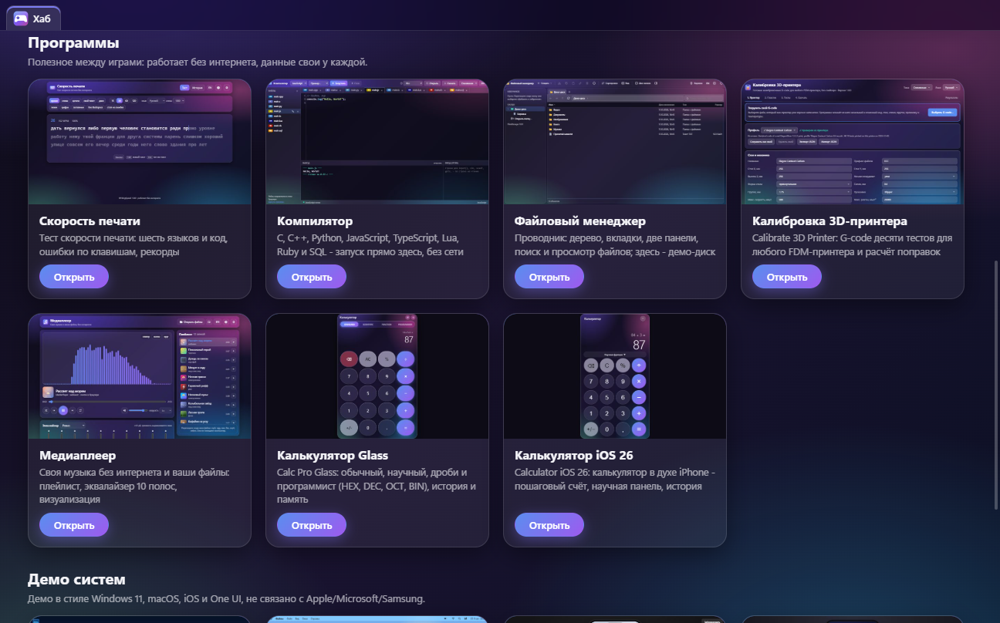
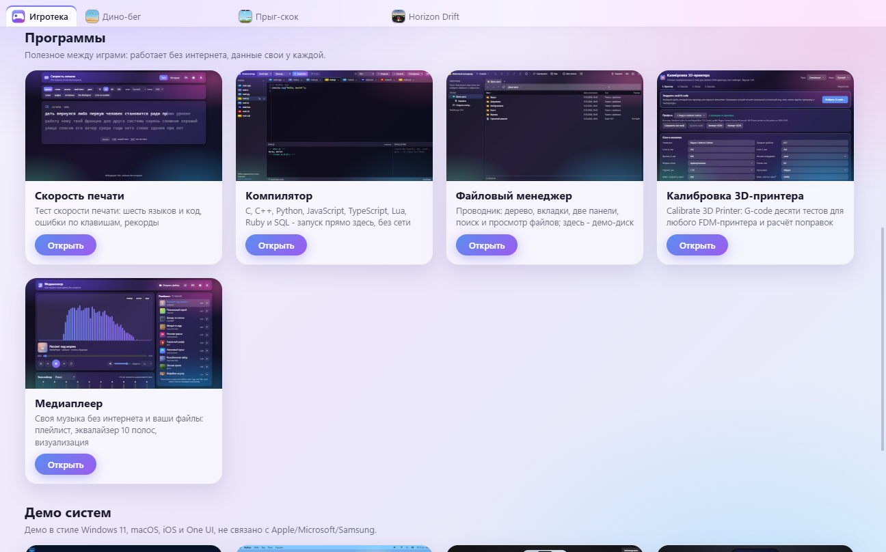

# Хаб (Hub)

[English](README.md) · **Русский**

**[▶ Открыть Хаб в браузере](https://alexalesha.github.io/)** (GitHub Pages); программа для
Windows - в [выпусках](https://github.com/ALEXalesha/ALEXalesha.github.io/releases).

Сборник небольших проектов, приведённых в порядок, и **«Хаб»**: приложение и страница, где игры,
программы и демо систем этого сборника открываются во вкладках одного окна. До версии 1.1.0
он назывался «Игротека»; настройки, рекорды и сохранения после переименования на месте.
Браузерная версия - корневой сайт https://alexalesha.github.io/.

- `web/` - 23 самостоятельные страницы HTML: игры, программы, демо оболочек. Каждая
  открывается двойным щелчком по `index.html` и работает без интернета.
- `py/` - 6 программ на Python (PySide6).
- `app/` - «Хаб», настольное приложение на Electron.



## «Хаб»

Одиннадцать игр в одном окне: «Кубический мир», «Блоксити», «Операция: Периметр», «Дино-бег»,
«Прыг-скок», «Horizon Drift», «Огненные джунгли», «Космический стрелок», «Блоки», «Судоку»,
«Летучая птичка» (Flappy Wings, «пролети между колоннами»).
Все игры -
фан-концепты и не связаны с правообладателями.



- **Программы.** Под играми - раздел «Программы», в нём пять программ: «Скорость печати»
  (WritingSpeed, `web/writing-speed`), тест скорости печати; «Компилятор» (`web/compiler`):
  C, C++, Python, JavaScript, TypeScript, Lua, Ruby и SQL запускаются прямо здесь, без сети;
  «Файловый менеджер» (`web/files-manager`) на демо-диске; «Калибровка 3D-принтера»
  (Calibrate 3D Printer, `web/calibrate3dprinter`): G-code десяти калибровочных тестов для
  любого FDM-принтера; «Медиаплеер» (`web/media-player`). Каждая открывается во вкладке, как
  игра, и работает без сети. От «Скорости печати» в приложение попадает только её страница
  (своя оболочка Electron и инструменты лежат рядом); «Компилятор» идёт со своими движками и
  Python из `web/python_ide` (около 80 МБ) и в «Хаб одним файлом» не входит.
  «Калибровка» живёт в своём репозитории ([сайт](https://alexalesha.github.io/Calibrate3dPrinter/));
  `web/calibrate3dprinter` - копия её папки `web/`, версия <!--calib-ver-->1.0.0<!--/calib-ver-->,
  обновляется командой `node tools/sync-calibrate.js [папка]` (или `CALIBRATE_DIR`). Ни одна
  карточка не уводит из приложения наружу.
- **Демо систем.** Под играми - раздел «Демо систем»: оболочки в духе Windows 11, macOS,
  iOS и One UI (`win11_3`, `macos-tahoe`, `ios26`, `oneui7`; не связаны с
  Apple/Microsoft/Samsung). Каждое открывается во вкладке, как игра, со своим хранилищем;
  игры в окнах демо получают громкость приложения, а уход с вкладки ставит их на паузу
  (`{mix: 'pause'}`).
- **Вкладки.** Каждая игра открывается в своей вкладке. Повторный щелчок по карточке
  переключает на уже открытую вкладку. Вкладки закрываются крестиком или средней кнопкой
  мыши.
- **Своё хранилище у каждой игры.** Рекорды и постройки одной игры не видны другой и
  сохраняются после перезапуска. Данные одной игры можно стереть в настройках, остальные
  игры это не затронет.
- **Фоновая вкладка стоит и молчит.** Скрытая игра встаёт на паузу, кадры ей не
  приходят, звук выключен. Проверено на всех восьми играх.
- **Без сети.** Страницы игр не могут выйти в интернет и прочитать файлы вне своей папки.
  Ссылка наружу открывается в системном браузере, но только после вопроса.
- **Окно запоминает** размер, место и развёрнутость, а также открытые вкладки. Повторное
  открытие вкладок можно выключить в настройках.
- Громкость и «без звука» для всего приложения, тёмная и светлая тема.

| Клавиши | Что делают |
|---|---|
| Ctrl+T | домашний экран |
| Ctrl+W | закрыть вкладку |
| Ctrl+Tab / Ctrl+Shift+Tab | следующая / предыдущая вкладка |
| Ctrl+1 … Ctrl+9 | вкладка по номеру (Ctrl+9 - последняя) |
| F11 | игра на весь экран, полоса вкладок прячется; Esc или F11 возвращают |
| F5, Ctrl+R, Ctrl+F5 | начать игру заново (после вопроса); ещё - правой кнопкой по вкладке |

Клавиши работают и в русской раскладке. «Кубический мир» забирает F1, F2, F3 и F5 себе
(F5 там переключает вид камеры), поэтому в нём начать заново - Ctrl+R, Ctrl+F5 или меню
вкладки. Какие клавиши игра забирает, записано в `app/games.js` (поле `keys`).

Esc в «Кубическом мире» тоже забирает себе игра (поле `escToGame`): первый Esc - пауза и курсор,
второй - снова игра, и курсор прячется сразу, без щелчка. Выйти из полного экрана оболочки в этой
игре - F11 (Esc остаётся у игры).

В браузере то же самое работает в полном экране **самой игры**: кнопка «Во весь экран (F)» в меню
паузы или клавиша F. Игра включает блокировку клавиатуры (`navigator.keyboard.lock(['Escape'])`,
есть в Chrome и Edge), поэтому Esc приходит в игру, а выйти из полного экрана - **удержать Esc**
(браузер сам подскажет) или нажать F. Полный экран браузера по F11 блокировку клавиатуры не
включает (её дают только странице в полном экране через Fullscreen API) - там, как и в обычном окне,
после второго Esc курсор вернётся по первому щелчку в игру (это правило безопасности браузера:
после выхода из захвата по Esc нужен новый щелчок).

| Вопрос поверх игры | Настройки | Светлая тема |
|---|---|---|
|  |  |  |

| Раздел «Программы» | «Программы», светлая тема |
|---|---|
|  |  |

Значок приложения нарисован кодом: `app/assets/logo.svg`, из него `npm run icon` собирает
`app/assets/icon.ico` (16-256 px, для 16-32 px упрощённый рисунок) и `icon.png`.


### Запуск, сборка, проверки

Нужен Node.js 22 или новее.

```
npm install
npm start                 # запустить приложение
npm run dist              # собрать установщик и portable в dist/
```

Сборка для Windows x64: `dist/Hub-1.1.0-Setup.exe` (NSIS, для одного
пользователя, без прав администратора, на русском) и `dist/Hub-1.1.0-Portable.exe`,
по 98 МБ. В сборку попадают только `app/` и папки одиннадцати игр.

```
npm test                  # страницы web/ в Chromium (1213 проверок)
npm run test:unit         # законы модулей приложения и значка (41)
npm run test:app          # настоящее приложение через Playwright (73, окна за экраном)
pip install -r requirements-py.txt
python -m pytest tests/py # программы py/ (183)
```

Вспомогательные команды: `npm run thumbs` снимает картинки карточек заново,
`npm run screenshots` снимает кадры для этого файла, `npm run probe:background`
показывает, что делает каждая игра в фоновой вкладке.
`npm run single` собирает `dist/hub-single.html` - весь Хаб со всеми играми
и демо систем в одном HTML-файле без сети (около 4,5 МБ).

### Браузерная версия

`index.html` в корне репозитория - тот же «Хаб» в обычном браузере: те же карточки,
описания и картинки, игры открываются во вкладках страницы, плюс раздел «Демо систем»
(win11_3, macos-tahoe, ios26, oneui7). Открыть - двойной щелчок по `index.html` или любой
статический сервер из корня репозитория (`npx http-server .`, `python -m http.server`).
Сборка, сервер и интернет не нужны, все пути относительные.

- Таблица игр одна на приложение и страницу: `web/_shared/games-data.js`. Порядок вкладок
  и настройки - те же модули `app/tabs.js` и `app/settings.js`.
- Ушли с игры (другая вкладка, домашний экран, скрыли вкладку браузера) - игре уходит
  `{mix: 'pause'}`, вернулись - `{mix: 'resume'}`; паузу снимает игрок.
- Хранилище у всех страниц сайта общее, игры разводят его приставками ключей (поле
  `storage` в таблице). «Очистить данные» стирает только выбранную игру.
- Громкость из настроек доходит до игр, когда страница открыта с сайта или сервера; с диска
  браузер считает страницы игр чужими, и громкость задаётся в самих играх.
- GitHub Pages: Settings → Pages → Deploy from a branch → `main`, папка `/ (root)`.
  Файл `.nojekyll` в корне обязателен: без него Pages выбросит папки с подчёркиванием
  (`web/_shared`, `web/_launcher`, `web/_os-shared`).
- На сайте страница изолирует себя сама (`hub-coi-sw.js` - service worker, который добавляет
  COOP/COEP только к файлам Хаба; соседние сайты того же адреса он не трогает). Поэтому
  «Компилятор» во вкладке Хаба ждёт строку, набранную в выводе, как на своём сайте. При
  первом заходе страница один раз перезагружается через него.

Законы страницы - `tests/weblauncher.spec.js` (входят в `npm test`): по `file://` и с
сервера из подпапки, как на Pages.

### Переименовать приложение

Имя записано в одном месте: поле `productName` в `package.json`. Его берут и само
приложение (заголовок окна, домашний экран, «О программе»), и сборщик (ярлыки,
установщик). Данные игр от имени не зависят и лежат в `%APPDATA%\MixOfProject-Games`,
поэтому после переименования рекорды не пропадут. Имена файлов сборки заданы латиницей
в `build.nsis.artifactName` и `build.portable.artifactName`. Их можно поменять
отдельно, если нужно.

## Страницы `web/`

Каждую страницу проверяет общий закон: страница открывается без ошибок и без сети. У
большинства страниц есть и свои законы в `tests/web/<имя>.spec.js`. Подробные разборы с
тем, что было и что исправлено, лежат в [docs/audit/games.md](docs/audit/games.md) и
[docs/audit/apps.md](docs/audit/apps.md). Оценки даны после правок.

**Игры** (оценки: интерес / отделка / своеобразие)

| Папка | Что это | Своих законов | Оценка |
|---|---|---|---|
| `tetris` | «Блоки»: падающие фигуры по правилам серии, с запасом и T-вращениями | 12 | 9 / 9 / 4 |
| `sudoku` | Судоку с решателем, подсказками, паузой и рекордами по уровням | 11 | 8 / 9 / 5 |
| `horizon_drift_offline` | Horizon Drift: 3D-гонки и дрифт, карьера, 8 машин и 8 трасс, свободная езда по 4 картам, повреждения | 104 | 8 / 7 / 7 |
| `space_shooter` | Космический стрелок: волны врагов и астероидов, бонусы, рекорд | 12 | 8 / 7 / 5 |
| `mario` | «Прыг-скок»: платформер на два уровня со своим героем | 13 | 7 / 8 / 5 |
| `jungle-strike` | «Огненные джунгли»: аркада-стрелялка с боссом | 11 | 7 / 7 / 6 |
| `minecraft_clone_3d_1` | «Кубический мир»: песочница из кубов, постройки сохраняются | 11 | 7 / 7 / 6 |
| `dino` | «Дино-бег»: бег с прыжками через кактусы и птиц | 11 | 6 / 8 / 3 |
| `flappy-wings` | «Летучая птичка»: пролети между колоннами, один файл; фан-игра, не связана с правообладателями известных игр жанра | 25 | пока без разбора |
| `fps_1` | «Операция: Периметр»: тактический шутер от первого лица, раунды против ботов | 10 | 6 / 7 / 4 |
| `roblox-mini` | «Блоксити»: город площадок - выбирай место и наряжай своего героя | 10 | 5 / 7 / 4 |

**Программы** (оценка 1-10: полезность, надёжность, доведённость)

| Папка | Что это | Своих законов | Оценка |
|---|---|---|---|
| `writing-speed` | «Скорость печати»: тест печати - время, слова, цитаты, свой текст, дзен; шесть языков и код; WPM/CPM, точность, ровность, ошибки по клавишам, рекорды. Ещё и отдельная программа на Electron (`web/writing-speed/electron`) | 91 | пока без разбора |
| `media-player` | Медиаплеер: 12 своих мелодий из генератора песен (Web Audio, ничего не скачивается), ваши файлы (звук и видео), плейлист, перемешивание и повтор, скорость, эквалайзер 10 полос, 3 вида визуализации, мини-режим, Media Session, пять тем Paint, RU/EN. Есть и отдельной программой на Electron (`web/media-player/electron`) и отдельным репозиторием: [MediaPlayer](https://github.com/ALEXalesha/MediaPlayer) | 45 (+23 мутанта) | ещё не оценён |
| `files-manager` | Файловый менеджер: дерево папок, плитки/список/таблица, вкладки, две панели, поиск по маске, просмотр картинок, текста, кода, аудио, видео, PDF, горячие клавиши Проводника, пять тем Paint, RU/EN. В браузере - демо-диск в IndexedDB или настоящие папки через File System Access API. Есть и отдельной программой на Electron (`web/files-manager/electron`, диск через IPC, удаление только в Корзину) и отдельным репозиторием: [FilesManager](https://github.com/ALEXalesha/FilesManager) | 3 (+1 Electron) | ещё не оценён |
| `compiler` | Компилятор: C, C++ (Clang 22 → WebAssembly), Python, JavaScript, TypeScript, Lua, Ruby и SQL в браузере; предел времени, «Стоп», ввод stdin и ввод по ходу программы, ошибки на своей строке, пять тем Paint, RU/EN. Есть и отдельным репозиторием: [Compiler](https://github.com/ALEXalesha/Compiler) | 32 (+23 мутанта) | ещё не оценён |
| `python_ide` | Python 3.13 без интернета: редактор, «Стоп», `input()`, файлы | 11 | 8 |
| `calculator` | Калькулятор с точной десятичной арифметикой и приоритетом операций | 40 | 8 |
| `english-abbreviations` | Словарь английских сокращений с умным поиском | 22 | 8 |

**Демо оболочек** (подробного разбора пока нет, проверяет только общий закон)

| Папка | Что это |
|---|---|
| `win11_3` | Оболочка в духе Windows 11 |
| `macos-tahoe` | Рабочий стол в духе macOS |
| `ios26` | Телефон в духе iOS |
| `oneui7` | Телефон в духе One UI |

## Программы `py/`

Все на PySide6 с одной тёмной темой. Проверки идут без экрана (`QT_QPA_PLATFORM=offscreen`).
Разбор - в [docs/audit/py.md](docs/audit/py.md).

| Файл | Что это | Проверок | Оценка |
|---|---|---|---|
| `paint.py` | Графический редактор: отмена, прозрачность, заливка, фильтры | 42 | 8 |
| `compiler.py` | Мини-компилятор своего языка в Python с понятными ошибками | 63 | 8 |
| `telegram_clone.py` | Чат с хранением переписки и поиском | 15 | 7 |
| `explorer.py` | Проводник, удаляет только в Корзину и только после вопроса | 20 | 7 |
| `os_sim.py` | «Python95»: рабочий стол, в окнах которого живут программы выше | 21 | 7 |
| `browser.py` | Браузер на QtWebEngine со своей стартовой страницей | 22 | 6 |

## Сторонние библиотеки

Лежат рядом со страницами без изменений, у каждой рядом текст лицензии.

| Библиотека | Где | Лицензия |
|---|---|---|
| three.js r149 | `web/{fps_1,horizon_drift_offline,minecraft_clone_3d_1,roblox-mini}/vendor/` | MIT |
| CodeMirror 5.65.21 | `web/python_ide/vendor/codemirror/` | MIT |
| Pyodide 0.29.5 (Python 3.13.2) | `web/python_ide/vendor/pyodide/` (им же пользуется `web/compiler`) | MPL-2.0; стандартная библиотека Python - PSF |
| YoWASP Clang 22 (Clang, LLD, wasi-libc, libc++) | `web/compiler/vendor/clang/` | Apache-2.0 WITH LLVM-exception; wasi-libc - Apache-2.0/MIT; YoWASP - ISC |
| ruby.wasm 2.10.1 (CRuby 3.4) | `web/compiler/vendor/ruby/` | MIT; Ruby - см. NOTICE |
| TypeScript 5.9.3 | `web/compiler/vendor/typescript/` | Apache-2.0 |
| sql.js 1.14.2 (SQLite) | `web/compiler/vendor/sqljs/` | MIT; SQLite - общественное достояние |
| Fengari 0.1.4 (Lua 5.3) | `web/compiler/vendor/fengari/` | MIT |
| Режимы и подсказки CodeMirror 5.65.21 | `web/compiler/vendor/codemirror/` | MIT |
| списки слов из wordfreq 3.1.1 (Robyn Speer), отобраны | блок `WORDS` в `web/writing-speed/index.html` | CC BY-SA 4.0 (только этот блок) |

Приложение собрано на Electron (MIT) и electron-builder (MIT), проверки - на Playwright
(Apache-2.0).

## Лицензия

MIT, см. [LICENSE](LICENSE). Все игры и программы - фан-концепты. Названия чужих
продуктов в описаниях нужны только для сравнения, с правообладателями проект не связан.
